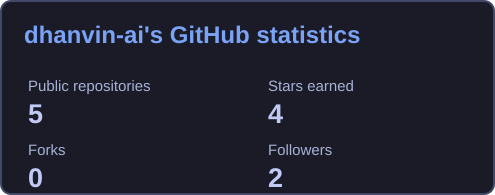
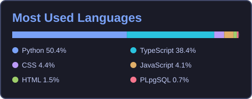

# Dhanvin Reddy

**B.Tech in Cyber Physical Systems @ Manipal Institute of Technology (2024-2028)**

Manipal,Karnataka

dhanvinreddy0137@gmail.com
🔗 [GitHub](https://github.com/dhanvin-ai) · [Tervik](https://www.tervik.in)

  

---

### About Me

I build tools that help developers understand **where AI agents fail and how to improve them**.

Currently building **[Tervik](https://www.tervik.in)** — failure analytics for AI agents, connecting conversations and tool calls to actionable problems and verified fixes.

My projects explore **agent evaluation, behavioral coverage, and developer tooling**, with Python backends and TypeScript interfaces.

---

### Highlighted Work

- **[Tervik](https://github.com/dhanvin-ai/Tervik):** Failure analytics for AI agents — conversation capture, silent-failure detection, and replay-based fix verification.
- **[RAVEN](https://github.com/dhanvin-ai/RAVEN):** AI agent evaluation and reliability platform — scenario testing, unsafe-behavior detection, reliability scoring, and regression tracking.
- **[AgentGarage](https://github.com/dhanvin-ai/AgentGarage):** Team project for the WeMakeDevs × AWS hackathon — behavioral coverage, sandbox verification, and permanent evaluations for confirmed agent failures.

---

### [Tervik](https://www.tervik.in) · AI Agent Analytics

- Capture **conversations and tool calls** through Python and Node clients.
- Detect **silent failures** such as unsupported action claims, failed tools, and repeated user corrections.
- Group related failures with the **messages and evidence** behind each problem.
- Support **coding-agent fixes** with replay-based verification before approval.
- Expose analytics through a **React dashboard and MCP server**.
- Built with **FastAPI, React, TypeScript, and PostgreSQL**, hosted on **Azure and Vercel**.

---

### Areas I’m Working On

- **Agent reliability:** evaluating behavior across realistic scenarios and tracking regressions.
- **Observability:** making conversations, tool outcomes, and failure patterns easier to inspect.
- **Developer workflows:** turning evidence from failing runs into reproducible evaluations and fixes.

---

### Connect With Me

  
  &nbsp;
  <a href="https://github.com/dhanvin-ai"><picture><source media="(prefers-color-scheme: dark)" srcset="https://raw.githubusercontent.com/dhanvin-ai/dhanvin-ai/main/assets/github-white.svg" /></picture></a>

---

### Languages & Tools

  

---

### 📈 GitHub Analytics

  

  

### Contribution Snake

  <picture>
    <source media="(prefers-color-scheme: dark)" srcset="https://raw.githubusercontent.com/dhanvin-ai/dhanvin-ai/output/github-contribution-grid-snake-dark.svg" />
    <source media="(prefers-color-scheme: light)" srcset="https://raw.githubusercontent.com/dhanvin-ai/dhanvin-ai/output/github-contribution-grid-snake.svg" />
    
  </picture>

---

*Building better tools for more reliable agents.*
